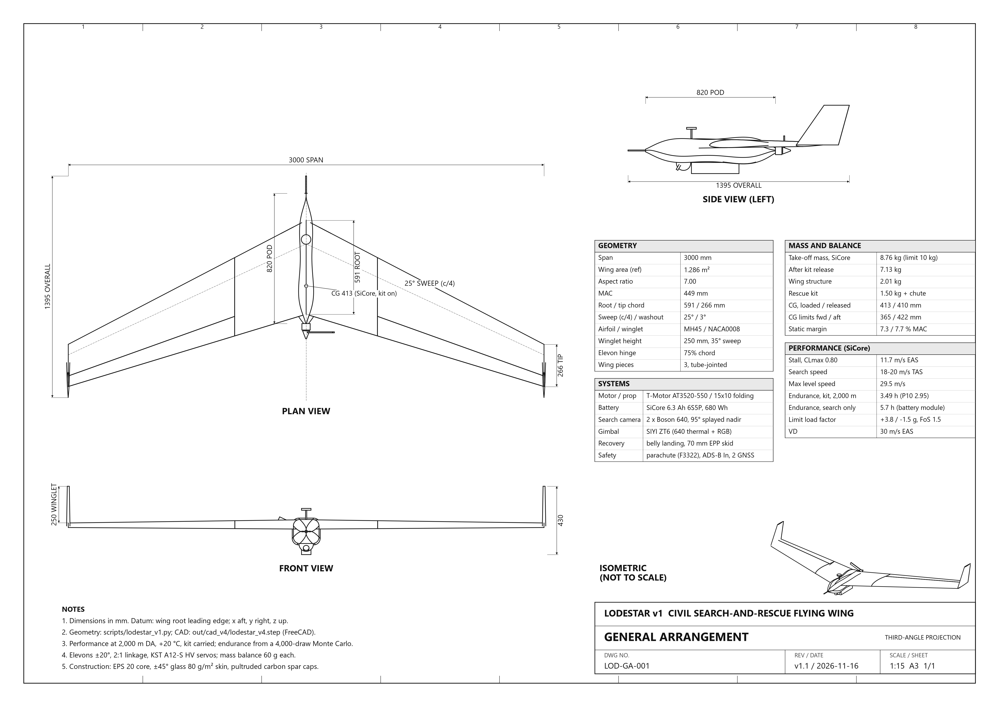
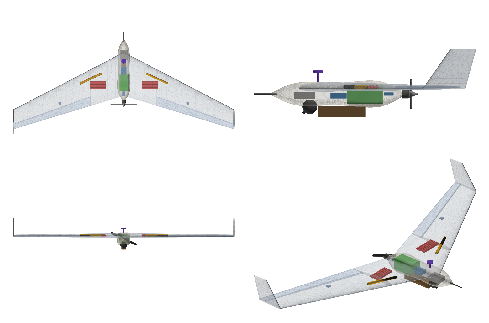
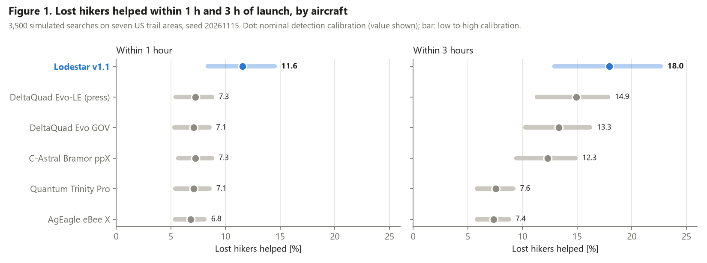
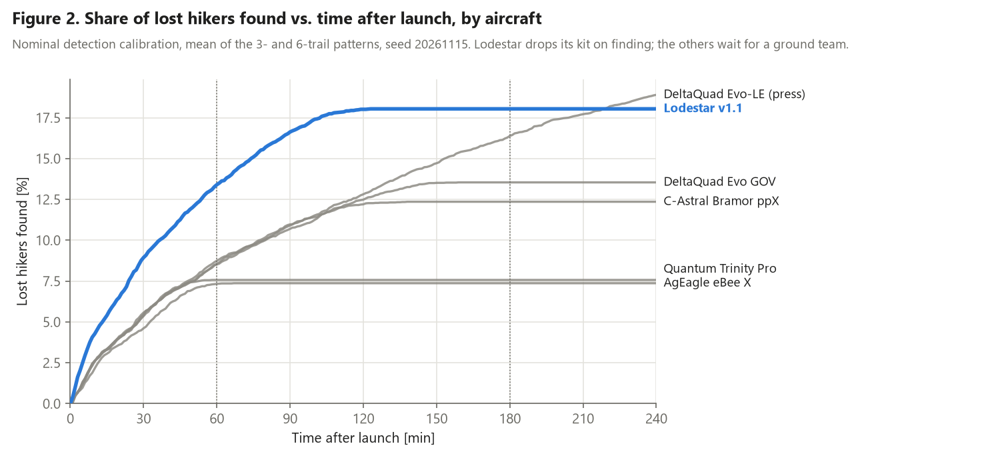
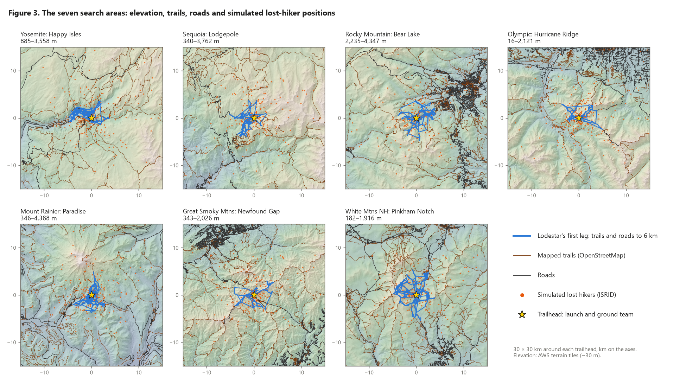
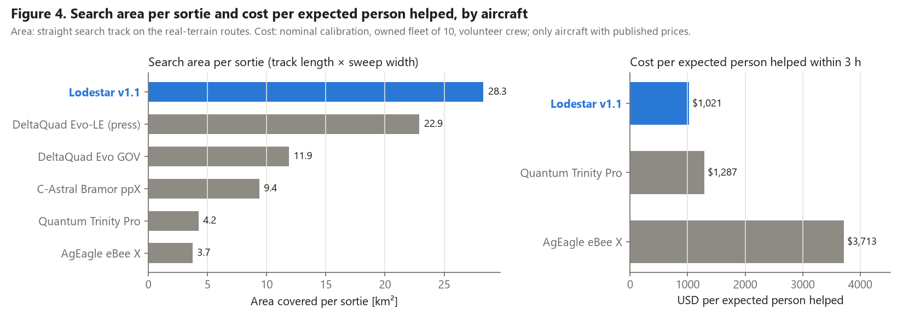
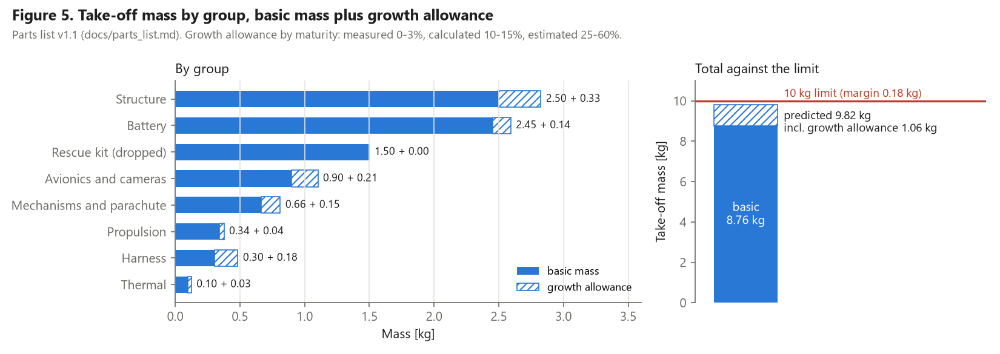
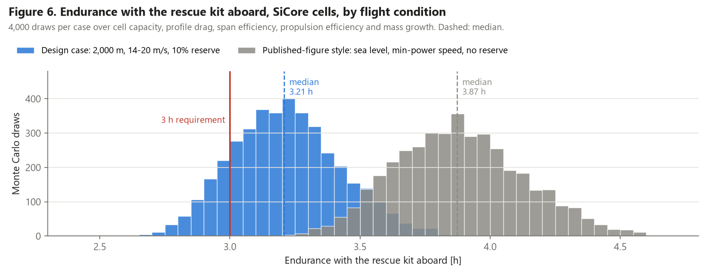
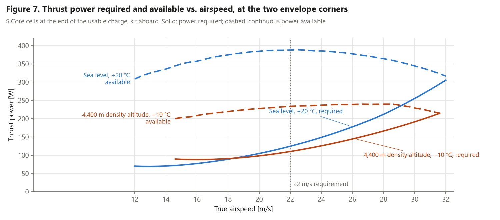
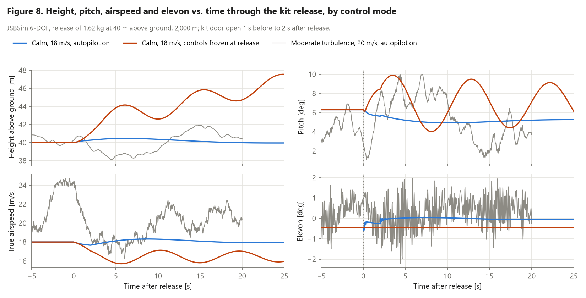

# Lodestar

A civil search-and-rescue flying wing: 3.0 m span, 8.8 kg, three and a half hours on a twin thermal camera, and a
1.5 kg survival kit dropped by parachute when it finds someone. A virtual design study with free tools and public
data. Released design: **v1, revision v1.1 (2026-11-16)**.

[](docs/drawings/LOD-GA-001_general_arrangement.pdf)

*General arrangement LOD-GA-001, A3 at 1:15. Click for the vector PDF.*



*FreeCAD assembly (`scripts/cad_v4.py`), skin transparent. Red: battery packs in the wing roots; green: rescue
kit; blue: avionics, servos and kit release; orange: wing-joint sleeves; purple: GNSS mast; dark grey: zoom gimbal;
brown: belly skid.*

## Result

Across 3,500 simulated lost-hiker searches on seven real US trail areas (terrain, canopy and trails from public
data, ISRID lost-person statistics), Lodestar gets help to the person within 3 hours in **18.0%** of searches at the
nominal detection calibration. The best fixed-wing search drone in the comparison, the DeltaQuad Evo-LE on its 8 h
press figure, gets **14.9%**. Within 1 hour it is **11.6% vs 7.3%**, because the kit makes contact without waiting
for a ground team to walk in.

| Help within 3 h [%] | Low | Nominal | High |
|---|---|---|---|
| Lodestar v1.1 (SiCore cells) | **12.9** | **18.0** | **22.7** |
| DeltaQuad Evo-LE (press) | 11.3 | 14.9 | 17.8 |
| DeltaQuad Evo GOV | 10.3 | 13.3 | 16.2 |
| C-Astral Bramor ppX | 9.4 | 12.3 | 14.9 |
| Quantum Trinity Pro | 5.8 | 7.6 | 9.2 |
| AgEagle eBee X | 5.8 | 7.4 | 8.8 |

Held-out seed 20261115, mean of the 3-trail and 6-trail patterns, three detection calibrations. Lodestar leads
every competitor in every cell. The one paired comparison whose 95% interval touches zero: against the Evo-LE at
3 h, low calibration, 6-trail pattern (+0.9 pp, −0.1 to +1.9). Full results, intervals and the method:
[research/2026-11-16-step2-results.md](research/2026-11-16-step2-results.md).





Lodestar finds people faster because its two thermal cores give an effective sweep width of 127 m, against 55 m for
a single gimbal camera. Its last finds come at about 2 h: after that it no longer has the energy to search further out
and still get home with its reserve. The Evo-LE, on its 8 h press figure, keeps searching and passes Lodestar's found
share after about 3.6 h. By then the 3 h help window has closed, and those hikers still wait for a ground team.

### The search areas



*30 × 30 km around each trailhead: AWS terrain tiles (~30 m), OpenStreetMap trails and roads, and lost-hiker
positions drawn from ISRID statistics. The blue routes are from the first real-terrain round (2026-11-13); the
v1.1 runs use the same seven areas with the trails-first pursuit route.*

## Design decisions

- **Tailless swept wing with winglets, not a VTOL.** Bungee launch and belly landing need no lift motors, so the
  10 kg budget goes to 680 Wh of battery, the cameras and the kit: 3.5 h with the kit aboard. The wing breaks into
  three pieces for a car.
- **Drop a kit instead of only reporting a location.** In the mission model, that alone is the difference at 1 h:
  contact happens when the kit lands, not when a ground team walks in.
- **Twin splayed thermal cores, not a single gimbal camera.** Two FLIR Boson 640s at ±22.5° give a 95° nadir view
  and a 136 m search track (2.5× a 32° gimbal). It is most of the +3.5 pp gain in help within 1 h from v1 to v1.1
  on a held-out seed. A SIYI ZT6
  gimbal stays for confirming finds and aiming the drop.
- **SiCore silicon-anode cells, not Molicel P50B.** The P50B build is cheaper but reaches only 2.8 h with the kit.
- **Foam-core wing (EPS 20 with glass skins and carbon spar caps), not moulded.** 2.0 kg including joints, no moulds.
  The FE model set the details: principal-stress cap sizing, a centre-section doubler and staggered ply drops.
- **Safety fit included.** Aircraft parachute, backup avionics supply, ADS-B In, strobes and a second GNSS follow
  from the hazard assessment: the trails-first route keeps the aircraft within 50 m of a trail for 46–68% of its
  track. With the other v1.1 additions they cost about 4% endurance.
- **Performance before cost.** Parts are $16.9k, against an $8k target that was set aside. Cost per expected person
  helped is still the lowest in the comparison ($810–$1,420); a camera cost-down comes in the next revision.



## Key engineering numbers



The predicted take-off mass is 9.82 kg: 8.76 kg from the parts list plus a growth allowance set by each line's
maturity. That leaves 0.18 kg to the 10 kg limit, the tightest margin in the design.



At nominal values the endurance with the kit is 3.49 h at the design case. With the model inputs varied, the median
is 3.21 h and 15% of draws fall below 3 h. The same aircraft quoted the way manufacturers quote (sea level, no
reserve) has a 3.87 h median, which shows how much quoting conventions alone move an endurance figure.



*Continuous thrust power covers the 22 m/s requirement at both envelope corners, from sea level at +20 °C to
4,400 m density altitude at −10 °C ([propulsion margins](research/2026-11-14-propulsion-battery-margins.md)).*



*JSBSim 6-DOF through the kit release at 40 m above ground. With the autopilot holding, height stays within 0.5 m
in calm air. With the controls frozen at release, it climbs about 7 m in a slow pitch oscillation. In moderate
turbulence at 20 m/s it stays within ±2 m ([6-DOF note](research/2026-11-15-sixdof-v1.md)).*

## Documents

| Document | What it covers |
|---|---|
| [Design report (PDF)](out/report/Lodestar_report.pdf) · [HTML](out/report/index.html) | One-page summary of the aircraft, results, checks, cost and limits |
| [General arrangement LOD-GA-001](docs/drawings/LOD-GA-001_general_arrangement.pdf) | Dimensioned three-view, geometry, mass and performance tables |
| [Parts list](docs/parts_list.md) | Purchased parts with prices and sources; mass lines with maturity |
| [Requirements compliance, v1.1](research/2026-11-16-v1.1-requirements-compliance.md) | Each requirement, its value and status |
| [Step 2 results](research/2026-11-16-step2-results.md) | Mission metrics P1–P8, the v1 → v1.1 changes, verification, gap closure |
| [Verification matrix](research/2026-11-15-verification-matrix.md) | Requirement → method → evidence |
| [System safety](research/2026-11-15-system-safety.md) | Hazard assessment, FMEA, contingencies, C2 link budget |
| [Wing FE](research/2026-11-15-wing-fea.md) · [Flutter](research/2026-11-14-flutter-verification.md) · [6-DOF](research/2026-11-15-sixdof-v1.md) | Structural, aeroelastic and flight-dynamics verification |
| [CHANGELOG.md](CHANGELOG.md) | Revision history |
| [PLAN.md](PLAN.md) | Original plan, requirements and milestone log |

## Reproduce

The design lives in one parameter file, [`scripts/lodestar_v1.py`](scripts/lodestar_v1.py). `freeze_check.py`
confirms that every analysis and every saved output agrees with it.

```
uv sync                                   # Python 3.13; or use the .venv
cd scripts
python -X utf8 run_all_tests.py           # every test and known-answer check, plus freeze_check (--full adds replays)
python -X utf8 freeze_check.py            # frozen design vs every script and output
python -X utf8 fleet_flyable.py --design v1.1 --seed 20261115     # headline mission run (about 1 h on 8 cores)
python -X utf8 step2_results.py           # P1, P2, P5 tables with paired intervals
python -X utf8 drawing_v1.py              # drawing LOD-GA-001
python -X utf8 readme_figures.py          # figures 1-8 in docs/figures (8 re-flies the 6-DOF release)
python -X utf8 parts_list_v1.py           # parts list
python -X utf8 report_pdf.py              # report PDF (headless Chrome or Edge)
```

External tools: FreeCAD 1.1 (CAD and CalculiX FE, run headless through `scripts/fcad/`), AVL and OpenVSP for
aerodynamics. Terrain is fetched by `scripts/terrain_fetch.py` (AWS terrain tiles, OpenStreetMap, NLCD canopy) and
is not stored in the repository.

## Layout

- `scripts/`: every analysis, one command each; `test_*.py` and `verify_*.py` are the checks.
- `research/`: dated engineering notes, one per study. Each opens with its answer.
- `out/`: results, CAD (STEP, STL) and figures. [`out/README.md`](out/README.md) says which folders belong to v1.
- `docs/`: release documents (drawing, parts list) and the README figures.
- `data/`: UIUC propeller data; terrain caches are fetched locally (`data/terrain/`, not in the repository).

## Limits

The detection calibration is the largest uncertainty: absolute help rates move by a factor of 1.6 across its range,
though the ranking does not change. The competitors are modelled from published figures. Allowables for skin
wrinkling on EPS, the joint stiffness and the cell resistance are assumed until coupon and bench tests are run.
Margins to watch are 0.18 kg to the 10 kg limit with the growth allowance, and 2.97 h at a fixed 20 m/s search speed
(3.49 h at best speed). Nothing has been built or flown.
