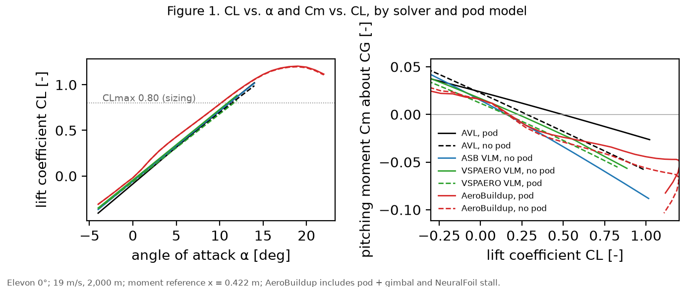
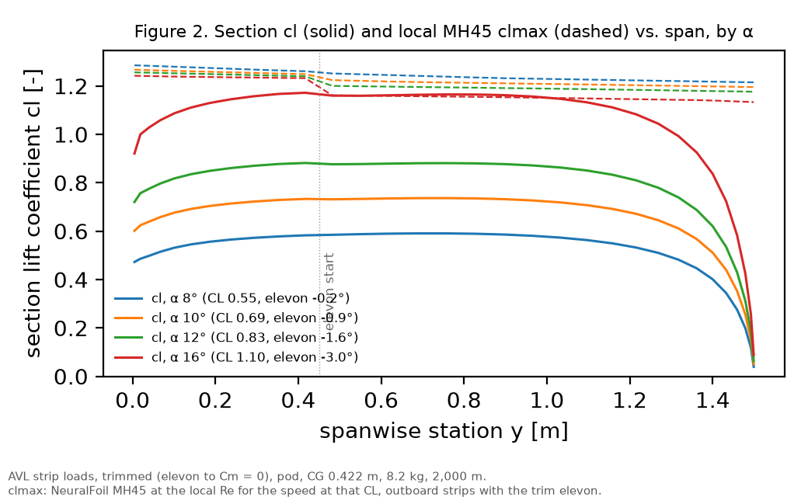

# Aerodynamic cross-check of the Lodestar wing by solver

2026-11-14

Code: `scripts/aero_crosscheck.py` (one command, about 30 min, most of it in VSPAERO). Outputs: `out/aero_crosscheck/` (CSVs, `run_log.txt`, figures, AVL and VSPAERO working folders).
Conditions throughout unless stated: 8.2 kg, 19 m/s, 2,000 m (ρ 1.005 kg/m³), trimmed CL 0.345, CG x = 0.422 m from the root leading edge, S 1.286 m², MAC 0.449 m, AR 7.0.

## Plain summary

- **The solvers agree on the things that matter.** Four independent methods put the neutral point within 3% of MAC of AVL once each is compared with the matching AVL case: AeroSandbox VLM, AeroBuildup, VSPAERO VLM, and VSPAERO with the pod. The lift slopes agree within 3% (9% at worst). The trimmed elevon is within 2° of neutral in every solver.
- **The neutral point is x = 0.444 m with the pod (AVL), so the static margin at the design CG is 4.8% of MAC, not 6%.** AeroBuildup gives 4.1%. The 6% figure came from the 15 m/s search case. At 19 m/s and 8.2 kg, the AVL slender-body pod costs a little more margin. Without the pod, every VLM gives 7.6-9.9%. **The aircraft is stable in every solver, but the margin is thinner than the design target.** If 6% is a hard requirement, move the CG about 5 mm forward, to x ≈ 0.417 m.
- **CLmax 0.80 is justified, with about 25% margin.** Three methods give a 3-D CLmax of 1.0-1.2:
  - critical section, trimmed (AVL): 1.10;
  - Raymer's handbook formula: 1.01;
  - AeroBuildup with NeuralFoil stall: 1.20.

  Even the lowest estimate (1.01) is 26% above 0.80.
- **Stall does not start at the root.** With 3° washout it starts mid-span, at y ≈ 0.83 m (55% of the semispan), just inside the elevon. The outer 40% of the wing and most of the elevon stay attached at first stall. That is acceptable for roll control, but it is not the root-first pattern. The washout sweep shows why: 0° washout gives first stall at 64% of the semispan and 5° gives 50%. Washout alone cannot pull it to the root on this planform.
- **Red flags:**
  1. Margin is 4.8%, not 6%.
  2. AeroBuildup's CD0 of 0.009 is very optimistic. The flight-identified Skywalker X8 has CD0 0.058, and OpenVSP's all-turbulent build-up gave 0.017. The real drag is likely between those last two, so endurance should keep using the cautious range.
  3. The winglet-wing junction is numerically fragile in AeroSandbox's VLM. I fixed it with a 2 cm modelling gap (see Method).

## Method

| Solver | What it models | Pod | Notes |
|---|---|---|---|
| AVL 3.52 | Vortex lattice, camber from MH45, flat-plate winglets | Slender body (equivalent-area round) | Primary tool, run through `avl_run.write_avl`, `run_trim`, `parse_strips` |
| AeroSandbox 4.2.10 VLM | Vortex lattice on the camber line; the elevon is modelled as a deflected airfoil camber line | None | Winglet root started 2 cm above the tip (below) |
| AeroSandbox AeroBuildup | Lifting line with NeuralFoil section data (viscous, with stall); slender-body/Jorgensen fuselage | Pod + gimbal | Semi-empirical; the only source of profile drag and post-stall lift here |
| VSPAERO 3.56 (VLM mode) | Thin-surface vortex lattice on the same `.vsp3` geometry as `vsp_model.py` | Optional thick pod + gimbal | Wing and winglets thin; pod as panels in the mixed run |
| flow5 7.58 | Not used | | GUI-only; no batch interface found |

All native tools ran; Windows Application Control blocked none of them.

Method notes:
- **Lateral derivatives** are converted to stability axes for every solver, because AVL reports in stability axes. The AeroSandbox and VSPAERO moments are in body axes; at α ≈ 5° the conversion changes Cn_β by up to 20%.
- **VSPAERO stability run:** its own stability file was inconsistent: Cm_α had the wrong sign in the wing-only run, and its X_np disagreed with its own polar. So:
  - x_np comes from the polar slope (Cm_α / CL_α);
  - Cl_β and Cn_β come from a ±2° sideslip sweep;
  - Clp and Cnr come from a re-run that I checked against the polar.
- **AeroSandbox VLM winglet junction:** with the winglet touching the twisted tip, the solution diverged as the mesh was refined (CL_α 4.5 → 24 per rad). Starting the winglet 2 cm up its own span line removed the problem. Convergence: x_np moved 0.3 mm between 20×12 and 28×14 panels (`vlm_resolution.csv`).
- **Bare-wing check** (no winglets, no pod): AVL x_np 0.456 m, AeroSandbox VLM 0.461 m. That is a 1.1% MAC gap before winglets are added.

## Results

### Table 1. Longitudinal coefficients and trim vs. solver, by pod model

Moments about x = 0.422 m; derivatives per rad; elevon positive trailing edge down. "Δ" is the difference from the matching AVL case (no pod vs. no pod, pod vs. pod): % of the AVL value, or % MAC points for x_np and SM, or degrees for trim.

| Quantity | AVL, pod | AVL, no pod | ASB VLM, no pod | Δ | VSPAERO VLM, no pod | Δ | VSPAERO VLM, pod | Δ | AeroBuildup, pod | Δ |
|---|---|---|---|---|---|---|---|---|---|---|
| CL_α | 4.59 | 4.34 | 4.45 | +2.3% | 4.43 | +2.0% | 4.27 | −7.0% | 4.73 | +2.9% |
| CL0 | −0.087 | −0.059 | −0.059 | +1% | −0.044 | +25% | −0.064 | +26% | −0.020 | +77% |
| Cm0 (about CG) | 0.028 | 0.027 | 0.020 | −25% | 0.020 | −27% | 0.017 | −40% | 0.017 | −40% |
| Cm_α | −0.220 | −0.350 | −0.434 | −24% | −0.338 | +3% | −0.333 | −52% | −0.336 | −53% |
| **Neutral point x_np [m]** | **0.444** | 0.459 | 0.467 | +1.8 | 0.456 | −0.5 | 0.457 | +3.0 | **0.440** | −0.7 |
| **Static margin [% MAC]** | **4.8** | 8.1 | 9.9 | +1.8 | 7.6 | −0.5 | 7.8 | +3.0 | **4.1** | −0.7 |
| Span efficiency e (inviscid unless noted) | 1.02 | 1.01 | 0.99 | −2% | 0.84 | −17% | 1.08 | +6% | 0.81 (viscous model) | −20% |
| Trim α [deg] | 5.17 | 5.48 | 5.82 | +0.3° | n/a | | n/a | | 4.86 | −0.3° |
| Trim elevon [deg] | +0.66 | −0.52 | −1.74 | −1.2° | n/a | | n/a | | −1.11 | −1.8° |
| CL_δe | 1.42 | 1.42 | 1.58 | +11% | n/a | | n/a | | 1.88 | +33% |
| Cm_δe | −0.70 | −0.70 | −0.78 | +12% | n/a | | n/a | | −0.62 | −11% |

Sources: `table_solvers.csv`, `table_differences.csv`, `polars_by_solver.csv`. AVL trim is AVL's own trimmed solution; the other trims solve the linear CL and Cm model of each solver.

### Table 2. Lateral-directional derivatives vs. solver, by pod model

Stability axes, per rad; Clp and Cnr per unit of p·b/2V and r·b/2V; derivatives taken at α = 5.17° (AVL trim).

| Quantity | AVL, pod | AVL, no pod | ASB VLM, no pod | Δ | VSPAERO VLM, no pod | Δ | VSPAERO VLM, pod | Δ | AeroBuildup, pod | Δ |
|---|---|---|---|---|---|---|---|---|---|---|
| Cn_β | 0.014 | 0.022 | 0.021 | −4% | 0.024 | +6% | 0.021 | +51% | 0.028 | +97% |
| Cl_β | −0.050 | −0.050 | −0.062 | +26% | −0.046 | −7% | −0.126 | +151% | +0.003 | sign |
| Clp | −0.443 | −0.443 | −0.481 | +9% | −0.503 | +14% | −0.516 | +17% | −0.515 | +16% |
| Cnr | −0.013 | −0.011 | −0.019 | +69% | −0.021 | +92% | −0.022 | +75% | −0.018 | +39% |
| Cl_δa (elevon as aileron) | −0.370 | −0.369 | −0.415 | +12% | n/a | | n/a | | −0.580 | +57% |
| Cn_δa | 0.016 | 0.017 | 0.019 | +14% | n/a | | n/a | | 0.002 | −91% |

Sign convention for Cl_δa: positive aileron means the right elevon trailing edge goes down. A negative Cl_δa means the airplane rolls left for that input, and a positive Cn_δa means proverse yaw.

### Differences over 10%, explained

- **Cm_α and Cm0.** Cm_α equals −CL_α × static margin, so a 2% MAC difference in neutral point becomes a 25-50% difference in a small Cm_α. The neutral point is the meaningful comparison, and it agrees within 3% MAC. Cm0 differs by only 0.007-0.011 in absolute terms. That is camber-line Cm (AVL, VLM) against NeuralFoil viscous section Cm (AeroBuildup); MH45's Cm0 is near zero, so small absolute errors look large.
- **CL0.** The absolute spread is 0.04-0.07, worth about 0.5-0.9° of zero-lift angle. AeroBuildup uses NeuralFoil's viscous zero-lift angle, and AVL uses thin-airfoil camber.
- **AeroBuildup and VSPAERO-with-pod against AVL with pod.** The two pod models differ. AVL's slender body moves the neutral point 15 mm forward. VSPAERO's thick pod on thin wings moves it only 0.7 mm, and AeroBuildup's moves it 6 mm. This is the same 2.5-15 mm spread found in [the milestone 3 note](2026-11-11-3d-model-and-aero.md). **AVL is the cautious end, and AeroBuildup independently lands 0.7% MAC from it, so 4-5% is the defensible margin at this condition.**
- **Span efficiency.**
  - The inviscid VLMs agree (0.99-1.08); the outliers are artefacts of method.
  - VSPAERO no-pod gives 0.84, but its wake-integrated value is inconsistent with its own pod case (1.08), so I don't trust it.
  - AeroBuildup's 0.81 is an empirical, viscous-adjusted value. It is the right one to use for endurance and matches the 0.80 used in sizing.
- **Control derivatives.** AeroBuildup's elevon effectiveness is 33% (pitch) and 57% (roll) above AVL. It takes flap effectiveness from 2-D NeuralFoil sections without 3-D or hinge-gap losses. AeroSandbox VLM is 11-12% above AVL because it uses a different camber-line deflection model. AVL is the most conservative for authority, so keep using it for actuator sizing.
- **Cl_β.**
  - AeroBuildup gives Cl_β ≈ 0 because it does not model the sweep or winglet dihedral effect. Ignore it.
  - VSPAERO with the thick pod gives −0.126, 2.5× every other solver. This is likely the thin-wing/thick-body junction problem flagged on 2026-11-11, so ignore that too.
  - AVL, AeroSandbox VLM and VSPAERO (no pod) agree within 26%.
- **Cn_β with the pod.** AVL's pod lowers Cn_β by 0.008, but VSPAERO's thick pod lowers it by only 0.002. AeroBuildup has no wing-winglet interference, so it treats the winglets as isolated fins and gives about twice AVL's value. AVL is the lowest, and therefore cautious, value.
- **Cnr.** All values are small (−0.011 to −0.022). Here AVL was run with no profile drag (cdp = 0), and in a VLM Cnr is dominated by profile-drag effects. The other solvers add winglet and induced terms differently. AVL is the low, cautious value for Dutch-roll damping.

### Drag and L/D (AeroBuildup, pod + gimbal, trimmed)

| Item | Value |
|---|---|
| CD0 (zero lift) | 0.0089 |
| Cruise CD at CL 0.345 | 0.0174 = profile 0.0093 + induced 0.0081 |
| By part at cruise | wing 0.0070, winglets 0.0007, pod 0.0014, gimbal 0.0003 |
| L/D max, trimmed, 8.2 kg | 22.1 at 21 m/s |
| L/D at 19 m/s | 21.9 |
| VSPAERO VLM with its own CDo estimate | L/D max 16.7 |

Sources: `drag_aerobuildup.csv`, `ld_vs_speed_aerobuildup.csv`.

The AeroBuildup wing profile drag assumes NeuralFoil's laminar runs, the same optimistic case as the sizing. The all-turbulent OpenVSP build-up (CD0 ≈ 0.017) and the X8 flight value (0.058, below) are reminders that real small airframes come in draggier. **I would not quote L/D 22 outside this note. A realistic planning range is L/D 15-19.**

### Figure 1

Figure 1. CL vs. α and Cm vs. CL, by solver and pod model. Elevon 0°, 19 m/s, 2,000 m, moment reference x = 0.422 m. The slope of each Cm-CL line is −(static margin). The solid black line (AVL, pod) is the shallowest: the thinnest margin.

## CLmax and stall onset

Method:
1. Run AVL trimmed, with the elevon set to Cm = 0 at every α, the pod on, and the CG at 0.422 m.
2. At each α, compare each strip's section cl with MH45's clmax from NeuralFoil. Use the local Reynolds number at the speed that gives that CL at 8.2 kg. On outboard strips, use the airfoil with the trim elevon deflected.
3. The 3-D "critical-section" CLmax is the CL at which the first strip reaches its clmax.

### Table 3. 3-D CLmax estimate vs. method

| Method | CLmax | First stall at |
|---|---|---|
| Critical section, AVL, trimmed (elevon −2.9° at stall) | **1.10** (α 15.9°) | y 0.83 m, 55% semispan |
| Critical section, AVL, elevon 0 | 1.13 | y 0.90 m, 60% |
| Critical section, AeroSandbox VLM, elevon 0, no pod | 1.13 | y 1.02 m, 68% |
| Raymer: 0.9 · clmax · cos Λ_c/4 (MH45 clmax 1.23 at Re 326k) | 1.01 | n/a |
| AeroBuildup peak CL (NeuralFoil stall, untrimmed) | 1.20 (α 19°) | n/a |
| Sizing assumption | 0.80 | |

Source: `clmax_summary.csv`. Raymer is from *Aircraft Design: A Conceptual Approach*, clean-wing CLmax estimate.

What this means:
- **0.80 is justified, with 26-50% margin across methods**, and stall at CL 0.80 corresponds to 12.5 m/s at 8.2 kg.
- Vortex-lattice critical-section estimates on swept wings tend to be optimistic, because spanwise flow thickens the outboard boundary layer. **Treat 1.0 as the realistic number.** Do not raise the sizing value above 0.9 without a glide or flight test.
- **Up-elevon at the stall matters.** Trim needs −2.9° of elevon at stall onset, which lowers the outboard clmax by about 0.07 at the elevon break (Figure 2). Roll inputs at the stall add up-elevon on one side. On that side the elevon section, which is already the first to stall, then reaches clmax sooner. **An autopilot roll limit near stall (or a CL limit around 0.9) is sensible.**

### Table 4. First-stall location vs. washout

AVL, trimmed, pod, 8.2 kg.

| Washout [deg] | CL at first stall | y of first stall [m] | Trim elevon at stall [deg] |
|---|---|---|---|
| 0 | 1.06 | 0.97 (64%) | −4.4 |
| **3 (design)** | **1.10** | **0.83 (55%)** | **−2.9** |
| 5 | 1.11 | 0.76 (50%) | −2.1 |

**Washout does not give root-first stall on this wing.** It moves first stall inboard and reduces trim elevon, but the root keeps a lower cl than the mid-span throughout:
- the swept, tapered planform loads mid-span ([Hepperle](https://mh-aerotools.de/airfoils/foil_flyingwings.htm));
- the root strip carries a centre-body lift dip (Figure 2).

3° is a reasonable compromise. At first stall the outer wing keeps some cl margin, smallest just outboard of the critical strip:

| Span station | cl margin at first stall |
|---|---|
| y 1.2-1.3 m | 6-9% |
| y 1.3-1.4 m | 13-19% |
| y > 1.4 m | over 25% | A root-first stall would need a different root airfoil with lower clmax, or a stall strip on the inboard leading edge. Both are flight-test items, not analysis items.

### Figure 2

Figure 2. Section cl (solid) and local MH45 clmax (dashed) vs. span, by α. AVL strip loads, trimmed, pod, CG 0.422 m, 8.2 kg, 2,000 m. The dashed clmax line steps down at y = 0.45 m, where the up-deflected elevon starts. First contact is at α ≈ 16°, CL 1.10, around y = 0.8 m.

## Comparison with the Skywalker X8

Reference: flight-identified model at 18 m/s, from [Løw-Hansen et al. 2025](https://elib.dlr.de/212985/1/s13272-025-00816-3.pdf), via the [2026-11-14 reference note](2026-11-14-aero-reference-data.md).

Normalisation: the lift slope is divided by the Helmbold/DATCOM lift-slope estimate for each planform's aspect ratio and half-chord sweep. For Lodestar, AR 7.0 and Λ_c/2 22.4° give 4.31 per rad. The X8's sweep isn't in the source, so the X8 row is shown for 20-35°.

### Table 5. Lodestar (AVL, pod) vs. Skywalker X8 (flight ID), by normalised quantity

| Quantity | Lodestar | X8 | Comparable? |
|---|---|---|---|
| Aspect ratio | 7.0 | 5.9 | Context only |
| CL_α [/rad] | 4.59 | 2.57 | No, see below |
| CL_α / Helmbold | 1.07 | 0.62-0.68 | Partly |
| Static margin [% MAC], −Cm_α/CL_α | 4.8 | 10.6 | Yes: the X8 flies with about twice Lodestar's margin |
| Cm0 | 0.028 | 0.027 | Yes: same reflex trim level |
| CL0 | −0.087 | −0.077 | Yes |
| CL_δe [/rad] | 1.42 | 1.37 | Yes, close |
| Cm_δe / CL_δe [MAC] | −0.49 | −0.20 | Partly: geometry-dependent |
| CD0 | 0.009 (AeroBuildup) | 0.058 | No: different things measured |

What is and isn't comparable:
- **Lift slope.** Lodestar sits slightly above the Helmbold estimate, as an inviscid VLM normally does. The X8's identified slope is about 35% below its own estimate. Likely reasons: a flexible foam wing, propwash, and the fact that flight identification at a single trim speed constrains CL_α poorly. **Don't infer that Lodestar's real lift slope is 40% lower.** Do expect real-world values 5-15% below VLM.
- **Static margin.** This is directly comparable as a fraction of MAC. The X8 operates at about 10%; Lodestar's 4.8% is on the lean side for a small flying wing. This supports restoring the 6% target, and it means early flights should run nose-heavy, at 8-10%.
- **Elevon pitch arm.** Lodestar's −0.49 MAC versus the X8's −0.20: Lodestar's elevons are outboard on a 25° swept wing, so their lift acts far behind the CG. The X8's identified value also absorbs correlated pitch-rate effects. The value is plausible, not a contradiction.
- **CD0.** The X8 value includes propeller, fuselage, and rough foam, and is identified with a linear k1·CL term. It is not a build-up number. It is the strongest evidence here that the 0.009 build-up is a floor, not a forecast.

## Styling options that do not cost performance

All variants keep the baseline wing. Each is evaluated by:
- AVL with the pod, through `stability.analyse` at 19 m/s (its 7.4 kg mass model, so the baseline margin reads 5.4% there; use the differences);
- AeroSandbox VLM Cn_β without the pod;
- AeroBuildup drag at α 5.17°.

### Table 6. Stability and drag change vs. styling variant

AVL, pod, 19 m/s; AeroBuildup for drag; 1 drag count = 0.0001 CD.

| Variant | Δx_np [mm] | Cn_β AVL | Cn_β ASB | Cl_β AVL | Dutch roll ζ | Spiral | ΔCD [counts] | Verdict |
|---|---|---|---|---|---|---|---|---|
| Baseline: 0.25 m, 35° sweep, taper 0.6, vertical | 0 | 0.0140 | 0.0213 | −0.052 | 0.126 | stable | 0 | |
| Winglet sweep 45° | −0.1 | 0.0143 | 0.0216 | −0.050 | 0.128 | stable | 0.0 | **Neutral, looks faster** |
| Shark fin: 50° sweep, taper 0.4 | −0.1 | 0.0134 | 0.0206 | −0.048 | 0.128 | stable | −0.7 | Neutral; Cn_β −4% |
| **Shark fin, 0.28 m tall** | 0.0 | **0.0180** | **0.0252** | −0.050 | **0.133** | stable | +0.1 | **Positive: +28% Cn_β, same drag** |
| Winglet taper 0.4 only | 0.0 | 0.0134 | 0.0206 | −0.051 | 0.125 | stable | −0.7 | Neutral |
| Cant 15° outward | +4.1 | 0.0122 | 0.0194 | −0.067 | 0.119 | stable | +0.8 | Mixed: margin +0.9 pts, e +1.5%, Cn_β −13% |
| Cant 15° inward | −2.4 | 0.0132 | 0.0207 | −0.034 | 0.131 | stable | +0.8 | Avoid: costs margin |
| Pod nose pointier (first station at 0.12 L, 70 × 60 mm) | −0.1 | 0.0141 | n/a | −0.052 | 0.125 | stable | −0.6 | **Neutral to positive** |
| Pod nose blunter (first station at 0.05 L, 110 × 100 mm) | −0.1 | 0.0137 | n/a | −0.052 | 0.128 | stable | +0.6 | Slight drag cost |

Source: `styling_options.csv`. All variants pass the MIL-F-8785C lateral criteria used in the stability note.

Recommendations for the looks pass:
1. **Swept, tapered "shark-fin" winglets** (50° LE sweep, taper 0.4), grown to 0.28 m so they keep their yaw authority. This is the one styling change that is clearly positive: 28% more Cn_β and better Dutch-roll damping for under 0.1 drag counts. The extra 3 cm should be checked for ground clearance and handling.
2. **A sharper, longer pod nose** saves about 0.6 counts and does not move the neutral point.
3. **Outward cant** (10-15°) adds a little margin and span efficiency but loses some yaw stiffness. Use it only together with option 1.
4. **Not evaluated numerically:**
   - Raked or rounded wing tips: the winglet carries the tip, so the effect is small.
   - A leading-edge fillet where the pod meets the wing: a smooth fillet reduces junction drag. It would need panel CFD, which VSPAERO did not handle cleanly here.

   Both are reasonable as long as the planform area and twist are unchanged.

## Caveats

1. **All lift and moment solvers here are potential-flow based.** None models flow separation before the stall, propwash, or the pusher prop's effect on pitch trim.
2. **The pod's effect on the neutral point still spans 1-15 mm across methods.** A glide test with CG markers is the cheapest way to settle the margin.
3. **NeuralFoil clmax is an ML fit to XFoil-like data.** The UIUC/Selig wind-tunnel MH45 polars were not checked against it.
4. **VSPAERO's stability-file output was unreliable at this setup** (WakeNumIter 5, thin surfaces), so its derivatives here come from polar sweeps.

## Feeds forward

- Static margin at 8.2 kg, 19 m/s is 4.8% (AVL) or 4.1% (AeroBuildup). Either restore 6% by moving the CG to about 0.417 m, or record 4-5% as the accepted value. Recheck the kit-drop margin at the new CG.
- Keep CLmax 0.80 for sizing; 1.0 is the realistic 3-D value. Add a near-stall roll and CL limit to the autopilot plan.
- Endurance: keep the cautious CD0 range (0.012-0.017). AeroBuildup's 0.009 is a floor.
- Styling: 50°/0.4 winglets at 0.28 m and a sharper pod nose are free or positive. Re-run `aero_crosscheck.py` after any change to the CAD.
