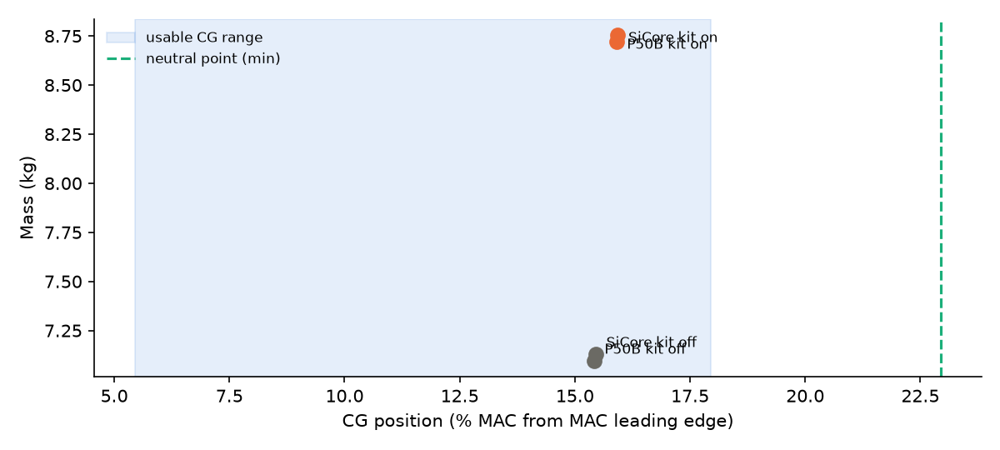

# Flight-control sizing: CG envelope, elevons, servos, roll and gusts

2026-11-14

Code: `scripts/controls_sizing.py` (one command, about 10 min, all AVL), checks in `scripts/test_controls_sizing.py` (9 known-answer checks, all pass). Outputs: `out/controls/` (CSVs, `run_log.txt`, `cg_envelope.png`).
Mass model: the v1 mass balance (`out/wing_trade/aircraft_mass_balance_v1.csv`): CAD v4 positions (`out/cad_v4/mass_cg.csv`, packs at x 0.427 m, y 0.330 m) plus the spanwise EPS 20 light wing. The script rebuilds it item by item and matches the CSV to within 0.004 mm of CG and 0.4 g of mass. Aero: AVL 3.52 with the pod slender body, 0.25 m winglets and 3° washout (`structures.GEO`). Elevon sign: positive = trailing edge down. Speeds are TAS unless marked EAS.

## Plain answer

**Yes: the airframe is controllable with margin in every mass state, and no change to the planform, elevon chord or winglets is needed.** The physical changes are all in the control-system hardware and the avionics installation.

| Item | Result |
|---|---|
| CG envelope | **x = 0.357 to 0.422 m** from the root leading edge (3.6% to 17.9% MAC), 64 mm wide |
| Aft limit | 5% MAC static margin, set by the most-forward AVL neutral point (0.444 m, at Vc) |
| Forward limit | elevon authority: pull to n = 3.8 at Vc (≈ VA) with 15° of up-elevon, keeping 5° for roll |
| The four mass states | x 0.4126-0.4146 m (16.0-16.4% MAC), **7-9 mm ahead of the aft limit** and 56 mm behind the forward limit. Static margin 6.8-7.6% |
| Kit release | CG moves 1.9 mm forward and 9 mm up; re-trim 0.7° of elevon. The 6-DOF result stands (it used a larger weight jump) |
| Elevon travel | ±20° mechanical. Trim needs −3.2° to +1.6°, pull-up to 3.8 g needs −5.6°, so pitch never uses more than about a third of it |
| Roll | 60° bank in 0.37-0.52 s with full travel, 0.49-0.69 s with 2/3 travel. MIL-F-8785C Class I Level 1 wants 1.3 s (Cat A) / 1.7 s (Cat B) |
| Servo | **≥ 0.9 N·m (9 kg·cm) stall torque with a 2:1 linkage** (≥ 1.8 N·m direct), ≤ 0.12 s/60°, 12-13 mm thick wing servo, HV (7.4-8.4 V) |
| Lateral modes | Dutch roll damping 0.11-0.14, spiral stable (halves in 29-106 s), all Level 1. 0.25 m winglets are adequate; 0.20 m would also pass |
| Gusts | A 7.6 m/s discrete gust stalls the wing at every search speed. Moderate Dryden turbulence uses up all of the stall margin at 15 m/s kit-on, about half at 18-20 m/s. No elevon or aileron saturation |
| 30° banked climb, 4,400 m | 6.3-6.6 m/s climb available at search speed (about 1 kW battery-power margin) |

**Physical changes required:**
1. **Linkage ratio about 2:1** (servo arm half the length of the horn arm) so a thin-wing servo carries the hinge moment. This also quarters free play and quadruples stiffness at the surface.
2. **Twisted power leads.** The pack-to-ESC leads must run as twisted or tightly paired cables. Run singly at full current, they put 21-36 µT at the compass, which is half the Earth's field.
3. **Longer pitot.** Extend the probe so its static ports sit at least 230 mm ahead of the pod nose (now about 110 mm, a 4% under-reading). Point it about 6° nose-down from the root chord.
4. **An ESC with RPM telemetry.** ArduPilot's harmonic notch tracks prop vibration from it.
5. **CG tolerance.** Build the CG to x = 0.411 ± 0.004 m. The margin to the aft limit is 7 mm by AVL, but only about 4 mm by AeroBuildup, which puts the neutral point 0.7% MAC further forward (`2026-11-14-aero-crosscheck.md`).

## 1. CG envelope

**Figure 1. Mass vs. CG position (% MAC), by mass state, with the usable CG range.** The usable range is shaded; the dashed line is the most-forward AVL neutral point. CG from the v1 mass balance. MAC 0.449 m, MAC leading edge at x = 0.341 m.

**Table 1. Static margin vs. flight condition, by mass state (AVL, trimmed level flight)**

| State | Mass [kg] | CG x [m] | CG [% MAC] | SM at Vc 22 m/s, SL | SM at 20 m/s, 2,000 m | SM at 15 m/s, 2,000 m |
|---|---|---|---|---|---|---|
| SiCore, kit on | 7.993 | 0.4146 | 16.4 | 6.8% | 7.0% | 7.6% |
| SiCore, kit off | 6.369 | 0.4127 | 16.0 | 7.0% | 7.1% | 7.4% |
| P50B, kit on | 7.959 | 0.4145 | 16.4 | 6.8% | 7.0% | 7.6% |
| P50B, kit off | 6.335 | 0.4126 | 15.9 | 7.0% | 7.1% | 7.4% |

The neutral point moves aft as CL rises (0.4441 m at Vc to 0.4488 m at 15 m/s), so the fastest case sets the aft limit. At 22 m/s and SL, Table 1 matches the v1 mass balance (6.8% / 7.1%) and the cross-check's x_np of 0.444 m.

**Table 2. Forward CG limit vs. design case (pitch budget 15° geometric up-elevon)**

| Case | V [m/s] | CL | n | Elevon sensitivity [° per cm of CG] | Forward limit x [m] | [% MAC] |
|---|---|---|---|---|---|---|
| 1 g at CLmax 0.80 (stall approach) | 11.2 | 0.80 | 1.0 | 1.69 | 0.347 | 1.3 |
| Flare: 1.2 Vs, pull to CLmax | 12.0 | 0.80 | 1.44 | 1.69 | 0.354 | 2.8 |
| **Pull-up n 3.8 at Vc (≈ VA)** | 22.0 | 0.78 | 3.8 | 1.65 | **0.357** | **3.6** |
| Pull-up n 3.8 at VD | 30.0 | 0.42 | 3.8 | 0.86 | 0.262 | not limiting |

*Conditions: SL, SiCore kit-on aerodynamics, steady pitch rate qc/2V = (n−1)g c̄/2V². AVL deflections are converted to geometric ones with a plain-flap effectiveness K′ that stays at 1 up to 10° and falls to 0.70 at 25° (DATCOM shape, assumed).*

**How the limits are set:**
- **Aft limit: 5% MAC.** Below about 5%, VLM uncertainty (±0.7% MAC between solvers) and build scatter eat the margin.
- **Forward limit: up-elevon.** Of the 20° of mechanical travel, 5° is kept for roll. MIL-F-8785C Class I Cat C, 30° of bank in 1.3 s at 1.2 Vs, needs only 3.4°, so 5° is the floor. That leaves 15° for pitch.

The forward limit sits 56 mm ahead of where the aircraft balances, so ballast or a heavier gimbal ahead of the CG is not a control problem. Moving aft is the risk.

### Kit release

**Table 3. Kit-release CG shift and re-trim vs. battery cell (15 m/s, 2,000 m)**

| Cell | Mass on → off [kg] | ΔCG x [mm] | ΔCG z [mm] | Weight jump | Trim elevon on → off |
|---|---|---|---|---|---|
| SiCore | 7.993 → 6.369 | −1.9 (forward) | +9.3 (up) | 25.5% | −1.30° → −0.63° |
| P50B | 7.959 → 6.335 | −1.9 | +9.4 | 25.6% | −1.29° → −0.62° |

**Is the 6-DOF result still valid? Yes, and it is conservative.** The 6-DOF run (`2026-11-11-cad-renders-6dof.md`) used 7.42 → 5.72 kg, a 29.7% weight jump, with a 0.5 mm CG shift. The v1 jump is smaller, 25.5%. The CG now moves 1.9 mm forward, which is the stabilising direction. The frozen-control transient scales with the weight jump, so expect about 0.86 × the old figures: roughly 7° of pitch and 8 m of climb. The autopilot case stays at about 2° and under 1 m. The elevon re-trim of 0.7° is well inside the servo deadband of the closed loop. I did not re-run JSBSim.

## 2. Elevon deflections, hinge moments and servo

**Table 4. Trim elevon vs. airspeed (TAS, 1 g), by altitude and mass state [°]**

| V [m/s] | SL, kit on | SL, kit off | 4,400 m, kit on | 4,400 m, kit off |
|---|---|---|---|---|
| 12.3 | −2.16 | −1.28 | below stall (14.0) | below stall (12.5) |
| 14 | −1.08 | −0.46 | −3.21 | −2.05 |
| 16 | −0.26 | +0.18 | −1.79 | −1.00 |
| 18 | +0.27 | +0.60 | −0.88 | −0.31 |
| 20 | +0.64 | +0.90 | −0.26 | +0.18 |
| 22 | +0.91 | +1.12 | +0.18 | +0.53 |
| 25 | +1.20 | +1.35 | +0.64 | +0.90 |
| 30 | +1.49 | +1.60 | +1.11 | +1.28 |

*SiCore shown; P50B is within 0.01°. AVL is inviscid, so trim depends only on CL and CG; altitude acts through CL. The full grid is in `trim_sweep.csv`.*

**Pull-up to n = 3.8 at Vc 22 m/s EAS:**
- At the actual CGs it needs −5.2° to −5.6° at SL and −4.5° to −4.8° at 4,400 m (27.5 m/s TAS).
- At the forward limit it needs −15° (by construction); at the aft limit, −4.1° (`pullup.csv`).
- CL 0.78 at 3.8 g means VA ≈ Vc: full deflection at Vc puts the wing right at the sizing CLmax.

### Hinge moments

**Method:** two estimates per case, and the larger is used.
1. **AVL** reports hinge moments for each control. I split them per side: H_R = (H_elevon + H_aileron)/2, H_L = (H_elevon − H_aileron)/2.
2. **Glauert thin-airfoil theory** for a 25% plain flap gives **Ch_α = −0.565 /rad and Ch_δ = −0.944 /rad** (flap-chord based). The code integrates the closed-form flap loading; it reproduces the textbook cl_δ = 3.826 and cm_δ = −0.650. These are applied as H = Ch·q·∫c_f² dy, with ∫c_f² dy = 0.00975 m³ per side and local incidence 1.1·CL/2π.

Thin-airfoil theory over-predicts real hinge moments. For a 10%-thick section with a finite trailing-edge angle, typical measured values are 0.6-0.8 × theory, but no XFOIL is installed to check the MH45. So the design value is conservative.

**Table 5. Hinge moment per elevon vs. load case (SiCore kit on, SL)**

| Case | V EAS | n | Elevon / aileron [°] | Most-deflected surface [°] | AVL [N·m] | Thin airfoil [N·m] | Design [N·m] |
|---|---|---|---|---|---|---|---|
| **VA (= Vc), 1 g, one surface on the 20° stop** | 22 | 1.0 | +0.9 / 19.1 | 20.0 | 0.72 | **0.89** | **0.89** |
| VA, 3.8 g, one surface on the stop | 22 | 3.8 | −5.2 / 14.8 | 20.0 | 0.60 | 0.73 | 0.73 |
| VD, 3.8 g pull + 1/3 roll reserve | 30 | 3.8 | −6.6 / 1.7 | 8.2 | 0.70 | 0.50 | 0.70 |
| VD, −1.5 g push + 1/3 roll reserve | 30 | −1.5 | +3.8 / 1.7 | 5.5 | 0.37 | 0.58 | 0.58 |
| VD, 1 g, full 20° (runaway bound, not a design case) | 30 | 1.0 | +1.5 / 18.5 | 20.0 | 1.32 | 1.71 | (1.71) |

*Load cases follow CS-VLA practice: full deflection up to VA, and a third of the roll deflection at VD. The roll rate is free (steady roll) where an aileron is applied.*

### Servo specification

**Table 6. Servo torque, travel and stiffness vs. linkage ratio, with 2× stall torque over the 0.89 N·m design hinge moment**

| Linkage ratio (horn arm / servo arm) | Servo stall torque | Servo throw for ±20° | Stiffness at the hinge | Free play at the surface | Surface rate from a 0.10 s/60° servo |
|---|---|---|---|---|---|
| 1:1 | ≥ 1.79 N·m (18.2 kg·cm) | ±20° | ≈ 68 N·m/rad | 0.30° | 600°/s |
| 1.5:1 | ≥ 1.19 N·m (12.1 kg·cm) | ±30° | ≈ 102 N·m/rad | 0.20° | 400°/s |
| **2:1** | **≥ 0.89 N·m (9.1 kg·cm)** | **±40°** | **≈ 136 N·m/rad** | **0.15°** | **300°/s** |

*Servo stiffness assumes stall torque is reached at about 1.5° of output deflection, typical of a digital servo's position loop. The stiffness of the pushrod, clevis and horn is in series and lowers these values. Free play assumes 0.3° at a new metal-gear servo plus clevis. Both are assumptions to measure on the bench.*

**Spec:**
- **Torque:** ≥ 0.9 N·m (≈ 9-10 kg·cm) stall at 7.4-8.4 V, metal gears, used with a 2:1 linkage.
- **Rate and travel:** ≤ 0.12 s/60° no-load, ±40° usable throw.
- **Size:** ≤ 13 mm thick, ≈ 30 × 32 mm footprint.

**Fit:** the servo bay at y = 0.87 m (chord 403 mm, bay at 60% chord) has 28.2 / 25.7 / 23.1 mm of airfoil thickness at 56 / 60 / 64% chord. After the 2 × 1.5 mm skin allowance that is 20-25 mm, so a **12-13 mm "wing servo" class fits with room for a frame.** One example of the class is the KST X12-508 (around 10 kg·cm at 8.4 V, 12 mm thick); check the datasheet before buying. A 10 mm servo (typically 4-6 kg·cm) is too weak even at 2:1.

**Rate:** the roll table below shows that a 300°/s surface rate costs under 0.02 s of bank time against 600°/s. The roll mode is fast (τ 0.04-0.09 s), so servo rate barely matters for roll. A ≤ 0.12 s/60° servo through 2:1 gives about 250°/s at the surface, which is ample.

**For the flutter analysis:** take about 136 N·m/rad at the hinge for a 9-10 kg·cm servo at 2:1, and 0.15° of free play at the surface. Both are estimates; measure them.

## 3. Roll performance

**Table 7. Roll performance vs. airspeed and roll share (2,000 m, SiCore kit on, servo 600°/s; 300°/s adds ≤ 0.02 s)**

| V [m/s] | Roll share | Aileron [°] | pb/2V | p [°/s] | τ_roll [s] | 0→45° [s] | 0→60° [s] |
|---|---|---|---|---|---|---|---|
| 15 | full (20° − trim) | 18.7 | 0.261 | 150 | 0.088 | 0.40 | 0.50 |
| 15 | 2/3 | 12.5 | 0.181 | 103 | 0.088 | 0.53 | 0.68 |
| 15 | 5° reserve only | 5.0 | 0.073 | 42 | 0.088 | 1.17 | 1.53 |
| 18 | full | 19.8 | 0.275 | 189 | 0.073 | 0.33 | 0.41 |
| 18 | 2/3 | 13.2 | 0.191 | 131 | 0.073 | 0.43 | 0.54 |
| 20 | full | 19.7 | 0.273 | 209 | 0.065 | 0.30 | 0.37 |
| 20 | 2/3 | 13.1 | 0.190 | 145 | 0.065 | 0.39 | 0.49 |
| 20 | 5° reserve only | 5.0 | 0.073 | 56 | 0.065 | 0.88 | 1.15 |

*Method: steady pb/2V = Cl_δa·δ_eff / (−Cl_p), with Cl_δa = 0.0064 per degree and Cl_p = −0.44 from AVL. Roll subsidence τ comes from the AVL eigenvalues, and the aileron ramps at the servo rate limit.*

**Against [MIL-F-8785C](https://www.scribd.com/document/116919829/MILSPEC8785C) §3.3.4, Table IXa (Level 1):**

| Class and category | Requirement |
|---|---|
| Class I, Cat A | 60° in 1.3 s |
| Class I, Cat B | 60° in 1.7 s |
| Class I, Cat C | 30° in 1.3 s |
| Class II-L, Cat A | 45° in 1.4 s |
| Class II-L, Cat B | 45° in 1.9 s |

Class I values are corroborated by a [secondary summary](https://scholar.afit.edu/cgi/viewcontent.cgi?params=%2Fcontext%2Ffacpub%2Farticle%2F2863%2F&path_info=aerospace_12_00012_v2.pdf). I could not open the original table online, so the Class II-L values are from memory of the standard and should be checked against it.

**How the aircraft compares:**
- **Full and 2/3 roll share:** both beat every Level 1 time by 2-3×.
- **Only the 5° roll reserve** (the forward-limit worst case): still meets Class I Cat B and Cat C, but not Cat A at 15 m/s (1.53 s vs 1.3 s).

**Combined pitch and roll travel.** Trim plus a 3.8 g pull uses at most 5.6° at the actual CG. That leaves at least 14.4° per side for roll before a surface hits the 20° stop. ArduPilot's `MIXING_GAIN` 0.5 sums pitch and roll and clips at the servo limits, so the travel stops must be mechanical stops beyond ±20°, not the servo's own end stops.

**Adverse yaw:** Cn_δa / Cl_δa = −0.04 to −0.06. It is small, and with no rudder it is left to the turn coordination in the roll controller.

## 4. Lateral-directional

**Table 8. Lateral-directional derivatives and modes vs. airspeed, kit on and off (AVL, SiCore)**

| Kit | Alt | V [m/s] | Cn_β [/rad] | Cl_β [/rad] | Dutch roll ω_n [rad/s] | Dutch roll ζ | τ_roll [s] | Spiral |
|---|---|---|---|---|---|---|---|---|
| on | 2,000 m | 15 | 0.017 | −0.070 | 2.67 | 0.106 | 0.088 | stable, halves in 29 s |
| on | 2,000 m | 20 | 0.014 | −0.049 | 2.87 | 0.111 | 0.065 | stable, 61 s |
| on | 2,000 m | 24.3 (Vc EAS) | 0.014 | −0.040 | 3.28 | 0.115 | 0.054 | stable, 86 s |
| on | SL | 30 (VD) | 0.015 | −0.032 | 4.33 | 0.131 | 0.036 | stable, 106 s |
| off | 2,000 m | 15 | 0.015 | −0.060 | 2.44 | 0.112 | 0.087 | stable, 37 s |
| off | SL | 30 | 0.015 | −0.029 | 4.34 | 0.143 | 0.036 | stable, 106 s |

*Short period ζ 0.60-0.71 and phugoid ζ 0.054-0.137 in all cases. Every case meets the MIL-F-8785C Level 1 limits used in milestone 2: Dutch roll ζ ≥ 0.08, ζω_n ≥ 0.15, ω_n ≥ 0.4, τ_roll ≤ 1.4 s, spiral time-to-double ≥ 20 s. The full table, including the 20 m/s kit-off case, is in `lateral_modes.csv`.*

**Winglets are adequate** (`winglet_check.csv`):

| Winglet height | Cn_β [/rad] | Dutch roll ζ at Vc (EAS) | Meets Level 1 |
|---|---|---|---|
| 0.20 m | 0.007 | 0.108 | yes |
| **0.25 m** | **0.014** | **0.115** | **yes** |
| 0.30 m | 0.023 | 0.125 | yes |

The heavier v1 mass and the pod model leave more margin than milestone 2 found. **Keep 0.25 m:** it doubles Cn_β over 0.20 m, which is the only yaw stiffness a rudderless wing has in crosswind and gusts.

### Crosswind

**A flying wing with no rudder cannot hold a steady sideslip.** The only yaw moment it can make is aileron adverse yaw, which is about 5% of the roll moment. So it **crabs** into a crosswind and weathervanes to β ≈ 0, both on the bungee launch and on the belly landing.

**The useful check is whether the ailerons can hold the wings level against the roll from a sideslip transient.**
- The full roll travel balances Cl_β·β for β beyond 45° at 13-20 m/s, because Cl_β is small (−0.03 to −0.07 /rad, sweep only, no dihedral). Roll control is not the limit.
- **What limits is the launch geometry.** A 12 m/s crosswind component on a 15 m/s launch is β = 53° off the rail: the aircraft would leave the launcher in a deep sideslip and yaw hard.

**Operating rule:** launch within about 30° of the wind direction. At 12 m/s of wind, that keeps the cross component under 6 m/s, which is β ≤ 24° at 15 m/s. Land crabbed; the skid takes the side load. A crosswind landing therefore needs no physical change, and the bungee launcher should be easy to re-point.

## 5. Gust response

**Table 9. Gust response vs. airspeed, kit on and off (2,000 m, SiCore)**

| V [m/s] | Kit | CL (1 g) | 1-cos 7.6 m/s, unstalled n | Stall-capped n | Elevon to hold attitude [°] | Lateral 1-cos: β [°] / aileron to hold wings level [°] | Dryden 3σ n | Dryden 3σ ΔCL vs stall margin | Dryden 3σ aileron (β + p gust) [°] |
|---|---|---|---|---|---|---|---|---|---|
| 15 | on | 0.54 | 3.13 | **1.63 (stalls)** | 6.9 | 26.9 / 5.1 | 1.47 | **0.25 vs 0.26** | 4.5 + 3.0 |
| 15 | off | 0.43 | 3.36 | 2.05 (stalls) | 5.9 | 26.9 / 4.4 | 1.53 | 0.23 vs 0.37 | 3.8 + 3.0 |
| 18 | on | 0.37 | 3.57 | 2.35 (stalls) | 5.5 | 22.9 / 3.5 | 1.57 | 0.21 vs 0.43 | 2.9 + 2.5 |
| 18 | off | 0.30 | 3.84 | 2.95 (stalls) | 4.8 | 22.9 / 3.0 | 1.64 | 0.19 vs 0.50 | 2.5 + 2.5 |
| 20 | on | 0.30 | 3.85 | 2.90 (stalls) | 4.8 | 20.9 / 2.8 | 1.63 | 0.19 vs 0.50 | 2.3 + 2.2 |
| 20 | off | 0.24 | 4.16 | 3.64 (stalls) | 4.3 | 20.9 / 2.4 | 1.71 | 0.17 vs 0.56 | 2.0 + 2.2 |

**Method:**
- **Discrete gust:** CS-VLA 1-cos shape over 25 c̄, plunge only, quasi-steady lift (no Küssner lag, so it slightly over-predicts). The stall cap is CLmax 0.80 × 1.10 dynamic overshoot. Elevon-to-hold = Cm_α·Δα/Cm_δ.
- **Lateral gust:** β = v/V, with no weathervane relief (conservative).
- **Dryden:** MIL-F-8785C low-altitude moderate turbulence (W20 = 30 kt) at 120 m AGL: σ_w 1.54 m/s, σ_v 2.03 m/s, L_w 120 m, L_v 275 m. Plunge transfer function for n and α. The rolling gust p_g comes from the MIL-F-8785C spectrum integrated over frequency (σ_p 8.2°/s).

**What it means:**
- **A 7.6 m/s sharp-edged gust stalls the wing at every search speed.** It is a 20-27° jump in incidence on a slow, lightly loaded wing, so peak n is set by stall: 1.6-3.6 g.
  - The kit-off 20 m/s case is at 3.6 g with the 0.80 cap, but would reach about 4.2 g if the real CLmax is near 1.0-1.1. That is above the 3.8 manoeuvre limit.
  - The structure is sized by the CS-VLA 15.2 m/s gust at Vc in `structures.py`, which covers this case.
- **In moderate turbulence at 15 m/s with the kit on, the 3σ lift jump (0.25) equals the stall margin (0.26).** This agrees with the 6-DOF finding that stalls happen in half the runs at 15 m/s. At 18-20 m/s the margin roughly doubles. That supports the existing rule: fly drop runs at 18 m/s in moderate turbulence.
- **No control saturates.** The largest pitch demand is 6.9° against the 15° budget. The largest roll demand is 5.1° against 18.7-19.8° available, and the Dryden 3σ roll demand, 7.5° summed, is still under half.

## 6. Climb in a 30° bank at 4,400 m

**Table 10. Banked-climb margin vs. battery cell (30° bank, 4,400 m, kit on, CAM 15×10 + T-Motor AT3520-550 on a sagging 6S)**

| Cell | V [m/s] | 30° bank stall [m/s] | Drag [N] | Battery power, level turn [W] | Thrust available [N] | Battery power at full throttle [W] | **Climb rate in the bank [m/s]** |
|---|---|---|---|---|---|---|---|
| SiCore | 20 | 15.0 | 5.1 | 152 | 31.1 | 1,150 (61 A) | **6.6** |
| P50B | 18 | 15.0 | 5.3 | 143 | 32.8 | 1,151 (61 A) | **6.3** |

*Method: `v3_propulsion` drag model and UIUC prop data at 4,400 m. Full throttle is limited by the motor's 1,100 W electrical limit.*

**Margin:** about 1 kW of battery power, a 6+ m/s climb while banked. The propulsion analysis should check:
- whether the packs can deliver 61 A, which is about 12 A per cell for a 6S5P pack;
- the motor and ESC temperatures at that power, in thin air.

## 7. Sensor and avionics placement (ArduPilot Plane)

**Positions from the CAD v4 layout** (`scripts/cad_v4.py`), x aft of the root leading edge, CG x ≈ 0.414 m:

| Part | Position |
|---|---|
| Flight controller (100 × 70 × 35 mm envelope) | x 0.25 m, 41 mm clearance in the pod |
| GPS + compass puck | on a 60 mm mast, x 0.12 m, top at z ≈ +0.105 m |
| ESC | x 0.565 m |
| Motor | x 0.69 m |
| Wing packs | x 0.427 m, y ±0.330 m |
| Pitot | x −0.28 to −0.14 m, on the axis; pod nose at −0.17 m |

**IMU (flight controller):**
- It sits 165 mm ahead of the CG. The kit bay occupies x 0.31-0.53 m, so it cannot go at the CG. Set `INS_POS1_X = +0.165`.
- **Vibration:** prop excitation at search is 65 Hz (shaft) and 129 Hz (blade pass), rising with throttle.
  - Mount the flight controller on soft isolators tuned to 15-25 Hz: below a third of the lowest excitation, and well above the 2-4 rad/s airframe modes.
  - Check that the logged vibration stays below the 30 m/s² guidance in [ArduPilot: measuring vibration](https://ardupilot.org/plane/docs/common-measuring-vibration.html).
  - Use the [harmonic notch](https://ardupilot.org/plane/docs/common-imu-notch-filtering.html) with `INS_HNTCH_ENABLE = 1`, `INS_HNTCH_MODE = 3` (ESC telemetry). **That requires an ESC with RPM telemetry** (bidirectional DShot or a telemetry wire).
- Soft-mount the motor to the pod tail if the logs show more than 15 m/s².

**Compass and GPS:**

| Source | Distance to the compass | Single lead at 61 A | Single lead at 5.6 A (cruise) | Twisted pair, 6 mm, at 61 A |
|---|---|---|---|---|
| Power bus at the wing root | 338 mm | 36 µT | 3.3 µT | 0.64 µT |
| Pack (nearest edge) | 414 mm | 30 µT | 2.7 µT | 0.43 µT |
| ESC | 467 mm | 26 µT | 2.4 µT | 0.34 µT |
| Motor | 587 mm | 21 µT | 1.9 µT | 0.21 µT |

*Earth's field is about 50 µT.*

Single leads are unacceptable at climb power, and twisted pairs are fine. **So route + and − together** from each pack to the ESC, keep the ESC-to-motor phase leads short, and run `compassmot` (sets `COMPASS_MOTCT`) per [ArduPilot advanced compass setup](https://ardupilot.org/plane/docs/common-compass-setup-advanced.html).

The motor's own magnets are a multipole ring, so their far field at 0.59 m is negligible next to the currents.

Set `GPS1_POS_X = −0.295` and `GPS1_POS_Z ≈ −0.125` (sign convention per [sensor position offsets](https://ardupilot.org/plane/docs/common-sensor-offset-compensation.html)).

**Pitot:**
- **Pod blockage.** The pod's slender-body source field slows the flow ahead of the nose.

  | Distance of the static ports ahead of the nose | Static-pressure error Cp | Airspeed reading |
  |---|---|---|
  | 110 mm (now) | +0.081 | 4.0% low |
  | 160 mm | +0.049 | 2.5% low |
  | 230 mm | +0.029 | 1.4% low |

  **Use a 250-280 mm probe with the ports at least 230 mm ahead of the nose.** Calibrate the rest with `ARSPD_RATIO` or `ARSPD_AUTOCAL` per [ArduPilot: airspeed](https://ardupilot.org/plane/docs/airspeed.html).
- **Propeller.** The pusher's induced inflow at the pitot (0.98 m upstream) is 0.02 m/s at search and 0.15 m/s at full thrust. That is negligible.
- **Angle.** α is 4.8° at search and about 12-16° near stall, and wing upwash adds 2-3° at the nose. **Tilt the probe about 6° nose-down from the root chord**, so that both search and approach fall inside a hemispherical probe's ±10° insensitivity band.
- **Protection.** The probe is the first thing to touch the ground in a belly landing, so use a carbon tube with a breakaway or push-fit mount.
- **Sensor.** Mount the differential sensor (MS4525DO or DLVR class) in the pod nose next to the probe, with short tubes.

**Remote ID:**
- Use a broadcast module on the pod top, aft of the GPS mast, at least 100 mm from the GPS antenna, under a glass or plastic skin (not carbon).
- An ArduRemoteID-type module can take position from the flight controller over DroneCAN or MAVLink ([ArduPilot: Remote ID](https://ardupilot.org/plane/docs/common-remoteid.html)).

**Antennas:**
- **Shielding.** The spar caps and joint tube are carbon and the wing skin is glass. Keep antennas out of the spar bay and the joint region.
- **RC and telemetry.** Put one vertical antenna in each winglet (glass, clear in every direction, about 1.5 m from the GPS). The other choice is under the pod belly, aft of the kit door.
- **Spacing.** Keep 2.4 GHz antennas at least 100 mm from the GPS puck.

**ESC:**
- It sits at the pod tail with 31 mm clearance.
- It needs a small inlet and outlet to cool it, because 61 A at climb power is several watts of loss.

**ArduPilot Plane setup the hardware must support** ([Elevon Planes guide](https://ardupilot.org/plane/docs/guide-elevon-plane.html)):

| Parameter | Value or use | What the hardware must provide |
|---|---|---|
| `SERVO1_FUNCTION` / `SERVO2_FUNCTION` | 77 / 78 (left / right elevon) | |
| `SERVO3_FUNCTION` | 70 (throttle) | |
| `MIXING_GAIN` | 0.5 | Sums pitch and roll, so the linkage must give ±20° at the surface from `SERVOn_MIN`/`MAX` with margin to the hard stops |
| `SERVOn_TRIM` | Set with the surfaces faired | |
| `SERVOn_REVERSED` | As needed | |
| `RLL2SRV_RMAX`, `PTCH2SRV_RMAX_UP` / `_DN` | Rate demands, about 150°/s roll and 60°/s pitch | The servo and linkage must reach the surface rates of Table 6 |
| `AIRSPEED_MIN` / `AIRSPEED_MAX` (`ARSPD_FBW_MIN`/`MAX` before Plane 4.5) | ≈ 14 / 22 m/s EAS (1.25 Vs loaded; Vc). `AIRSPEED_CRUISE` 15-17 EAS | |
| `STALL_PREVENTION` | 1, limits bank at low speed | Matches the cross-check's advice to limit roll near stall |
| `INS_POS1_X`, `GPS1_POS_*`, `INS_HNTCH_*`, `COMPASS_MOTCT` | As above | |
| `TKOFF_THR_MINACC`, `TKOFF_THR_DELAY` | For the bungee launch | Keeps the pusher prop stopped until the aircraft has left the launcher |
| `Q_ENABLE` | 0 | No VTOL, so no Q_ parameters |
| `YAW2SRV_DAMP`, `KFF_RDDRMIX` | Unused | No rudder |

Tuning reference: [roll and pitch controller tuning](https://ardupilot.org/plane/docs/roll-pitch-controller-tuning.html).

## Caveats

1. **AVL is linear and inviscid.**
   - Elevon effectiveness above 10° uses an assumed K′ curve.
   - Trim near CLmax ignores the up-elevon clmax loss that the cross-check found (−2.9° at stall onset).
   - Hinge moments from AVL and thin-airfoil theory bracket a value that a viscous method (XFOIL, or a wind-tunnel or bench test) should pin down. The design uses the larger value.
2. **Servo stiffness and free play are estimates.** Measure torque against deflection on the bench, with the real linkage, before the flutter clearance is final.
3. **The forward limit is set by a 3.8 g pull at Vc with 15° of up-elevon.** If the mechanical travel is cut to ±15° to unload the servos (design hinge moment 0.67 N·m), the forward limit moves aft. Re-run the script with `TRAVEL = 15`.
4. **Gusts use plunge-only quasi-steady models.** The closed-loop 6-DOF Monte Carlo (milestone 5) remains the reference for bank and height excursions.
5. **The magnetic field numbers assume straight wires.** The real harness, and the field of the ESC's own switching loop, must be checked with a compass calibration and a motor-current sweep on the bench.
6. **MIL-F-8785C Class II-L roll times are unverified.** I could not open the original table online, so those values come from memory of the standard. The Class I values are corroborated by a secondary source.

Sources: [MIL-F-8785C](https://www.scribd.com/document/116919829/MILSPEC8785C); [AFIT flying-qualities paper (Class I roll times)](https://scholar.afit.edu/cgi/viewcontent.cgi?params=%2Fcontext%2Ffacpub%2Farticle%2F2863%2F&path_info=aerospace_12_00012_v2.pdf); ArduPilot Plane docs linked inline.
